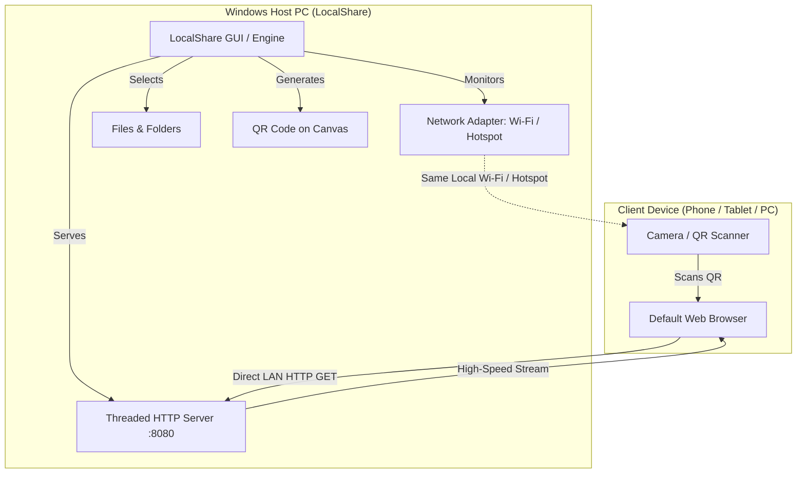

<div align="center">

# ⚡ LocalShare

**High-Speed, 100% Offline Device-to-Device Local Wi-Fi File Sharing**  
*Transfer files and folders at maximum Wi-Fi speed between Windows PC and any device (Phone, Tablet, Mac, Linux, PC) — Zero Internet Data Required.*

[](#)
[](#)
[](#)
[](#)

</div>

---

## 📖 Overview

**LocalShare** is a fast, calm, and lightweight Windows application engineered to solve a common everyday frustration: **sharing files between a Windows PC and mobile devices or other computers without uploading to the cloud, without cords, and without consuming internet data.**

Operating over your local Wi-Fi or mobile hotspot, LocalShare launches an in-memory HTTP server and renders a dynamic QR code. Any phone, tablet, or laptop on the same network can scan the code to instantly view, stream, or download individual files, or grab an entire multi-file batch compressed as a `.zip` in one click.

---

## ✨ Key Features & Highlights

### 🛡️ 100% Offline & Private
- Operates strictly across your Local Area Network (LAN / WLAN).
- Zero telemetry, zero cloud relays, and zero internet data consumption.
- Files stream directly from your PC storage to the receiver's device at hardware Wi-Fi speeds (typically **30 MB/s – 100+ MB/s**).

### 📶 Smart Real-Time Network Detection
- Constantly monitors network adapter states in real time:
  - **When Disconnected:** Automatically highlights a calming rose-tinted banner (`⚠️ Not Connected to any Wi-Fi or Hotspot Network!`) and immediately pops up the Windows Wi-Fi flyout so you can connect in one click.
  - **When Connected:** Displays an emerald green status badge with the active network SSID name and local IP address (`🟢 Connected: <Network_Name>`).
  - **Auto-Lock:** The file selection controls remain safely hidden until an active Wi-Fi or Hotspot connection is established.

### 📁 Direct Unified File & Folder Selection
- **Single-Click Universal Picker:** No clumsy dropdown menus. Clicking **`[ 📄 Add File(s) or Folder ]`** invokes the native Windows Open Dialog (`IFileOpenDialog`), allowing you to select multiple files or full directories in a single operation.
- **Recursive Folder Preservation:** Selecting a folder automatically maps and packs all nested subdirectories and files with preserved relative paths.
- **Live Interactive Chips:** Selected items are presented in sleek preview chips with intuitive file-type emojis, clean human-readable sizes, and one-click remove buttons.

### 🔄 Live Auto-Sync (No Browser Reload / No Re-scan)
- If you add or remove files while sharing is active, changes are instantly synchronized with the live server.
- The receiver's mobile browser automatically updates its file inventory in real time via asynchronous polling and cache-busting headers—no page refresh or QR re-scanning needed!

### 📲 Calming & Modern Responsive Mobile Web Portal
- Scanning the QR code opens a soothing, luxury dark-themed mobile web application:
  - **Instant Preview & Media Streaming:** Videos, photos, audio, and documents (PDF, TXT, code) can be viewed directly in the mobile browser with byte-range streaming support.
  - **Batch Download:** When multiple files are shared, a **`📦 Download All (ZIP)`** button bundles all files into an on-the-fly zip stream.
  - **Adaptive View:** Clean, responsive flex layouts ensure long filenames never overflow or break out of cards.

### 🎨 Luxury Obsidian Desktop Interface
- Engineered with high-contrast typography and a soothing dark obsidian palette (`#0b0f17`).
- **Embossed Signature Badge:** Features a luxury embossed brand badge in the header for **`BIBHANSHU`**.
  - **Smooth Shutter Animation:** Hovering over the badge smoothly rolls down an animated shutter revealing `bibhanshuya@gmail.com`.
  - **Quick Copy:** Clicking copies the email address directly to your Windows clipboard.
- **Protected Viewport:** Boundary-locked mousewheel scrolling prevents the heading and controls from scrolling out of view when content fits on screen.

---

## 🖥️ System Architecture



---

## 🚀 How to Run

LocalShare is packaged to run flexibly depending on your environment:

### Option 1: Standalone Executable (Recommended)
> **No Python installation required!** Runs out-of-the-box on Windows 7, 8, 10, and 11.
1. Simply double-click **`LocalShare.exe`**.
2. Portable and compact (~18 MB)—ideal for carrying on a USB drive.

### Option 2: Silent Launch via VBScript
- Double-click **`LocalShare.vbs`**.
- Launches the application silently in the background with zero visible console window.

### Option 3: Batch Launcher
- Double-click **`LocalShare.bat`**.
- Automatically checks for `LocalShare.exe` or falls back to Python.

### Option 4: Run from Python Source
If you prefer running or modifying the Python script directly:
```powershell
# 1. Clone repository
git clone https://github.com/<your-username>/localshare.git
cd localshare

# 2. Install lightweight dependencies
pip install pillow qrcode

# 3. Launch application
python localshare.py
```

---

## 📋 Step-by-Step Usage Guide

```
[ Step 1: Open App ]
         │
         ├──► Disconnected? ──► Red Banner & Wi-Fi Flyout opens ──► Connect to Wi-Fi
         │
         └──► Connected? ─────► Emerald Banner displays SSID & IP
                                      │
                                      ▼
                           [ Step 2: Select Items ]
                               Click "Add File(s) or Folder"
                               Select your files/folders
                                      │
                                      ▼
                           [ Step 3: Start Sharing ]
                               Click "🚀 Share Files"
                                      │
                                      ▼
                           [ Step 4: Scan & Download ]
                               Scan QR Code on Phone
                               View or Download at lightning speed!
                                      │
                                      ▼
                           [ Step 5: Finished ]
                               Click "🔄 Reset" to close connection
```

1. **Launch LocalShare:** The dashboard opens and validates your network connection.
2. **Add Files:** Click **`📄 Add File(s) or Folder`** to select files or full directory trees.
3. **Click Share:** Click **`🚀 Share Files`**. A high-contrast QR code and local URL will appear.
4. **Scan with Any Device:** Open your phone camera or browser on the same Wi-Fi, scan the QR code, and download or stream files at maximum speed.
5. **Reset:** Click **`🔄 Reset`** anytime to instantly terminate the local server, clear selections, and reset the interface.

---

## 📂 Project Structure

```
localshare/
├── LocalShare.exe       # Standalone portable Windows executable (No Python needed)
├── localshare.py        # Complete application source code (GUI, Server, Network monitor)
├── LocalShare.bat       # Windows command launcher script
├── LocalShare.vbs       # Silent Windows VBScript runner (no terminal flicker)
├── .gitignore           # Git ignore rules for build files and caches
└── README.md            # Comprehensive project documentation
```

---

## 🛠️ Built With

- **Python 3.14 / 3.8+**
- **Tkinter & Tcl/Tk** - Native, responsive, zero-bloat Windows GUI
- **ctypes & Win32 COM** - Native Windows `IFileOpenDialog` integration
- **ThreadingHTTPServer** - High-throughput multi-threaded HTTP chunk streaming
- **Pillow (PIL)** - Image processing & QR rendering
- **qrcode** - Standard high-density QR matrix generation
- **PyInstaller** - Single-file standalone executable compilation

---

## 👨‍💻 Author

**Bibhanshu**  
- **Email:** [bibhanshuya@gmail.com](mailto:bibhanshuya@gmail.com)  
- **GitHub:** [https://github.com/](https://github.com/)

---

## 📄 License

This project is open-source and available under the [MIT License](LICENSE).
